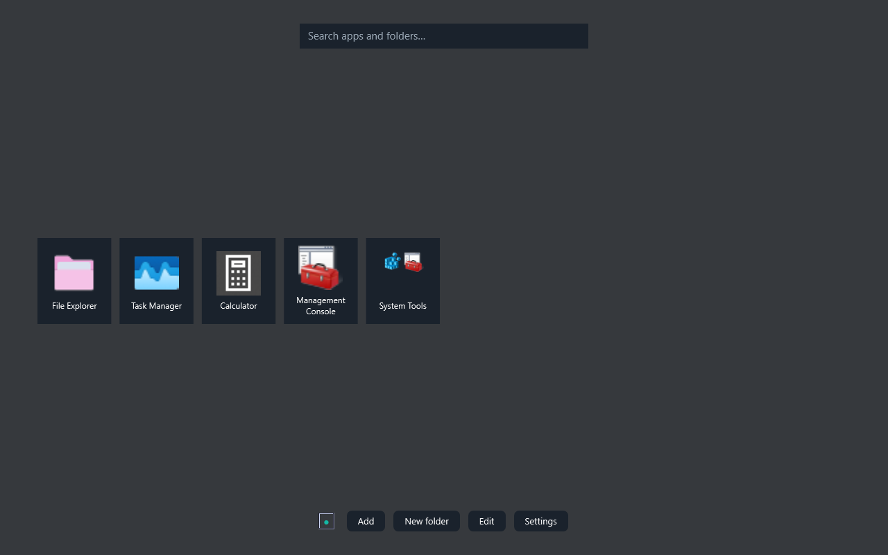
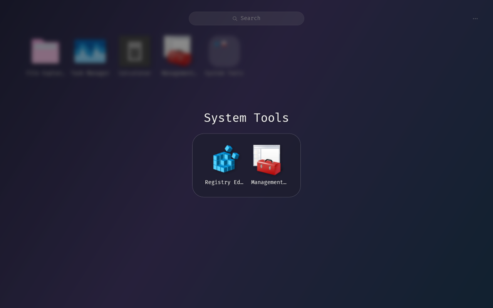
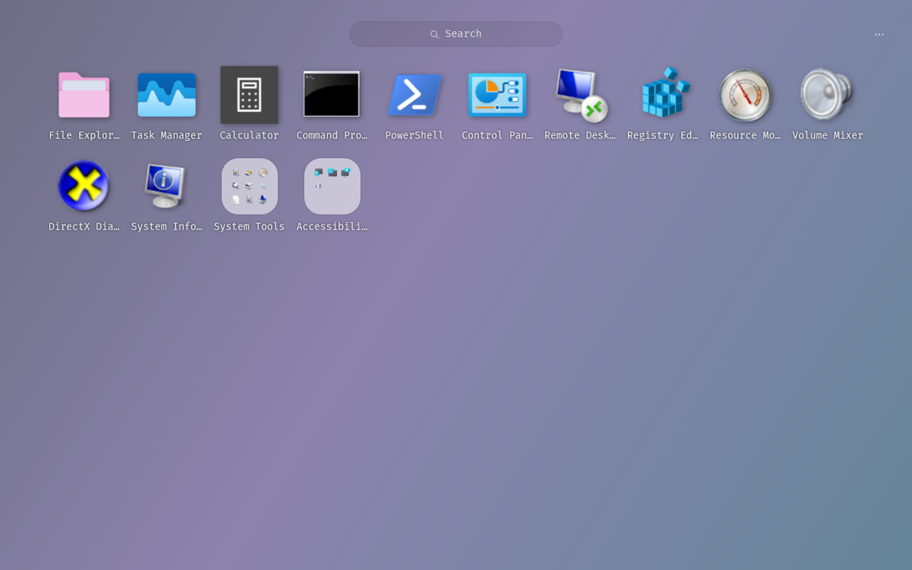
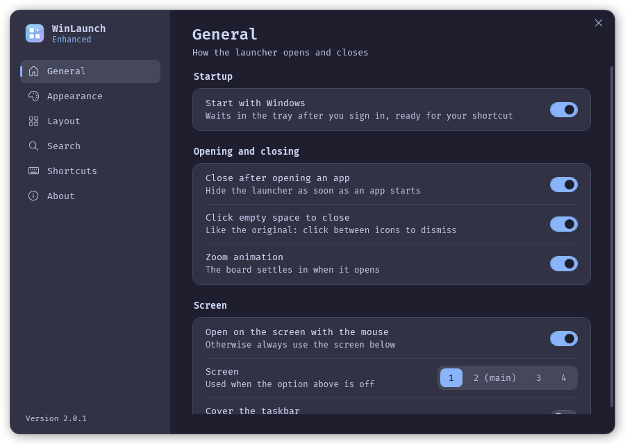
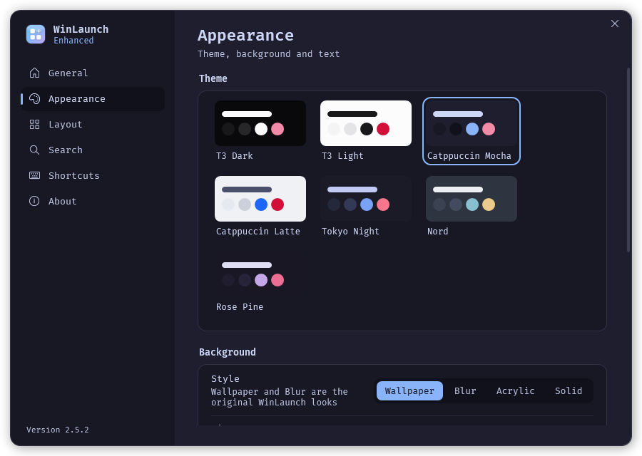
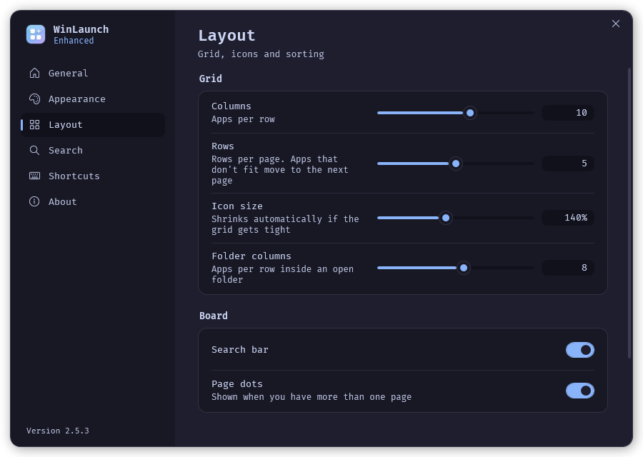

# WinLaunch Enhanced

A rewrite of [WinLaunch](https://github.com/jensroth-git/WinLaunch) (MIT, (c) 2022
MrC0rrupted) for Windows 11. It keeps the original Launchpad look: your wallpaper
blurred behind floating icons, glass folders that preview their first nine apps, a
search pill at the top and page dots at the bottom. It runs on .NET 10 WPF instead of
.NET Framework 4.8, loads 256 px shell icons in the background, and ships seven
themes, with Catppuccin Mocha as the default.

## Install

Download the setup file from the
[latest release](https://github.com/DavidHiFi/WinLaunch-Enhanced/releases/latest).
It installs for your user account only, adds Start menu and desktop shortcuts, can
start WinLaunch when you sign in, and installs the .NET 10 Desktop Runtime for
you when it is missing. Uninstalling from Windows Settings leaves your WinLaunch
data in place.

No install wanted? Grab the portable zip from the same release instead. It runs
as is, keeps its data beside the exe, and never touches the registry.





## Works with your existing WinLaunch data

Enhanced reads and writes the same files as WinLaunch 0.7.x, in the same place
(`%APPDATA%\WinLaunch`, or next to the exe for portable installs):

- `Items.xml`, `Settings.xml`, `LinkCache\`, `IconCache\` and `ICBackup\` are shared,
  so both apps open the same apps and folders, custom icons included.
- The blur preference in your `theme.xml` is used until you pick a background.
- Every save first copies the previous `Items.xml` into `ICBackup\` and keeps the
  last 10.
- Saves are crash-safe: the new file is written and flushed to disk before it
  replaces the old one, so a power cut or forced restart mid-save leaves the old
  file intact. If `Items.xml` is ever empty or damaged anyway, Enhanced restores
  the newest readable copy from `ICBackup\`, tells you, and keeps the damaged
  file as `Unreadable-Items-*.xml`. `Settings.xml` keeps its last good copy as
  `Settings.xml.bak`.
- Opening Enhanced does not reorder anything. Saved positions stay as they are
  until you move a tile.

## Using it

- Open and close it with your shortcut (the original's is picked up), a hot corner
  or the tray icon. It stays closed while a game or video is fullscreen.
- Type anywhere to search. Enter opens the top result, and Ctrl+Shift+Enter opens
  it as administrator. Search also matches the keywords you give an app, and can
  rank the apps you open most first. Type a sum such as `12*4.5` to get the answer.
- Change pages with the mouse wheel, a swipe, the page dots, PageUp and PageDown,
  or Ctrl+Left and Ctrl+Right.
- Right-click an app for Open, Run as administrator, Always run as administrator
  (a tick that makes a normal click run it elevated), Open file location, Edit,
  Rename, Move to page and Remove. Right-click a folder to open, edit, rename,
  move or remove it.
- Right-click empty space, or use the `+` and `...` buttons, to add an app or
  file, a folder shortcut, a web link, a new folder, or every Start menu app you
  have not added yet. Inside an open folder, the same menu adds straight into it.
- Edit changes an app's icon (any image, .ico or .exe), name, path or web address,
  arguments, search keywords, notes (shown in the tooltip) and whether it always
  runs as administrator. For a folder it changes the icon, name, notes and whether
  the app previews show.
- Edit layout (press Ctrl+E or use the menu) makes the tiles wiggle. Press and
  move a tile to drag it at once, with or without edit mode. Drop a tile on the
  middle of an app to make a folder of the two, on a folder to move it inside,
  or anywhere else to move it there. Drag an app out of an open folder to take
  it out, and rest at the left or right edge to turn the page. The badge removes
  a tile, and Undo or Ctrl+Z brings it back for a few seconds.
- Drop shortcuts or programs on the board to add them. Apps whose target is
  missing are dimmed.

## Settings

Settings change the launcher as you adjust them:

- General: start with Windows, close after opening an app, click empty space to
  close, opening animation, add and settings buttons, which screen to use, and whether it covers the taskbar.
- Appearance: seven themes (T3 Dark and Light, Catppuccin Mocha and Latte, Tokyo
  Night, Nord, Rose Pine); a wallpaper, blur, acrylic or solid background with dim
  and blur strength; font, text size, text shadow and whether names show.
- Layout: columns, rows, icon size, folder columns, search bar, page dots, and
  alphabetical sorting with folders first.
- Search: rank by use, calculator, and clearing the usage history.
- Shortcuts: the global shortcut, the fullscreen guard and hot corners.
- About: updates (check on startup, manual check, download and install), back up, export and import `.WLbackup` files, reload, and remove all apps.





## Not ported

Double-tap, middle-mouse, gamepad and voice activation, the desktop shortcut
watcher, custom background images, and languages other than
English. See DESIGN.md for the visual direction if you want to contribute.

## Build and run

```powershell
dotnet build src/WinLaunch.Enhanced/WinLaunch.Enhanced.csproj
dotnet run --project src/WinLaunch.Enhanced
```

It uses your live data unless you pass a folder as the first argument:

```powershell
dotnet run --project src/WinLaunch.Enhanced -- "D:\some\WinLaunch-copy"
```

`pwsh packaging\build.ps1` publishes the app, builds the installer and the
portable zip into `dist\`, plus a `SHA256SUMS` file for both (needs Inno
Setup 6).

## Checks

```powershell
# Counts every tile, resolves every link and round-trips the XML of your data.
dotnet run --project tools/VerifyData

# Builds the real window offscreen and prints counts. Shows nothing, saves nothing.
dotnet run --project src/WinLaunch.Enhanced -- "<dataset-copy>" --smoke

# Re-renders the screenshots in docs/.
dotnet run --project tools/PreviewRender

# Checks the updater rules against canned release lists (no network).
dotnet run --project tools/PreviewRender -- --update-test

# Moves the real mouse through the drags on a copy of your data (into a folder,
# press and drag at once, live reflow, app onto app, empty spot, hold then drag,
# out of a folder, reorder inside a folder, edge paging). Your cursor moves on
# its own for a few seconds.
dotnet run --project tools/PreviewRender -- --data "%APPDATA%\WinLaunch" --drag-test

# Opens the real launcher full screen on a copy of your data and prints frame
# times for opening, edit-mode wiggle, a drag, a page change and a folder.
dotnet run --project tools/PreviewRender -- --data "%APPDATA%\WinLaunch" --perf Acrylic

# Works on a copy of a dataset: opens every right-click menu (board, tiles, open
# folder) and checks web links, folder shortcuts, the Start menu scan and custom icons.
dotnet run --project tools/PreviewRender -- --data "%APPDATA%\WinLaunch" --no-settings --route-test --out "%TEMP%\wl-check"
```

## Switching from the original WinLaunch

1. Copy `%APPDATA%\WinLaunch` somewhere safe. Enhanced also backs up on every save.
2. Quit the original WinLaunch, which holds your shortcut.
3. Start Enhanced. It shows the same apps and folders.
4. To go back, quit Enhanced and start the original. There is nothing to migrate.

## Project layout

- `src/WinLaunch.Legacy`: the shared file formats (`Items.xml`, `Settings.xml`,
  `theme.xml`), data paths, link resolution and pre-save backups.
- `src/WinLaunch.Enhanced`: the app.
- `tools/VerifyData` and `tools/PreviewRender`: the checks above.
- `DESIGN.md`: palette with measured contrast, and motion rules.

## License

MIT. The original copyright, (c) 2022 MrC0rrupted, is kept; see LICENSE.
